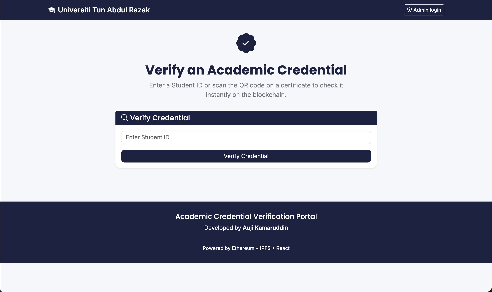
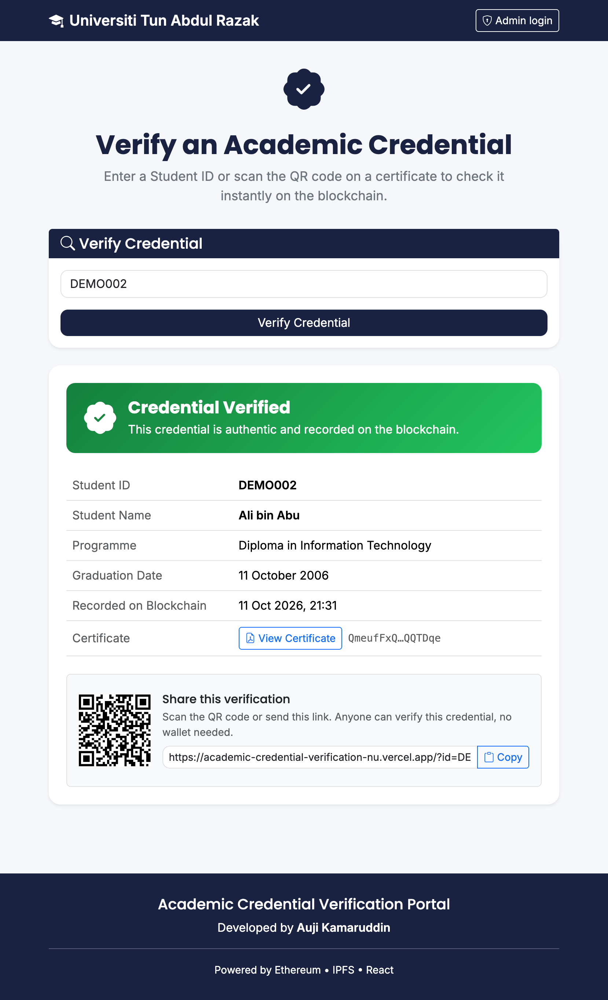
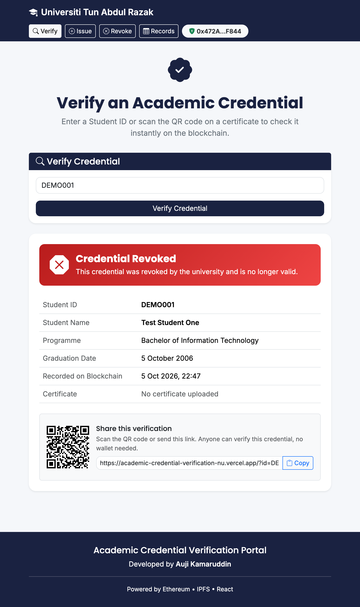
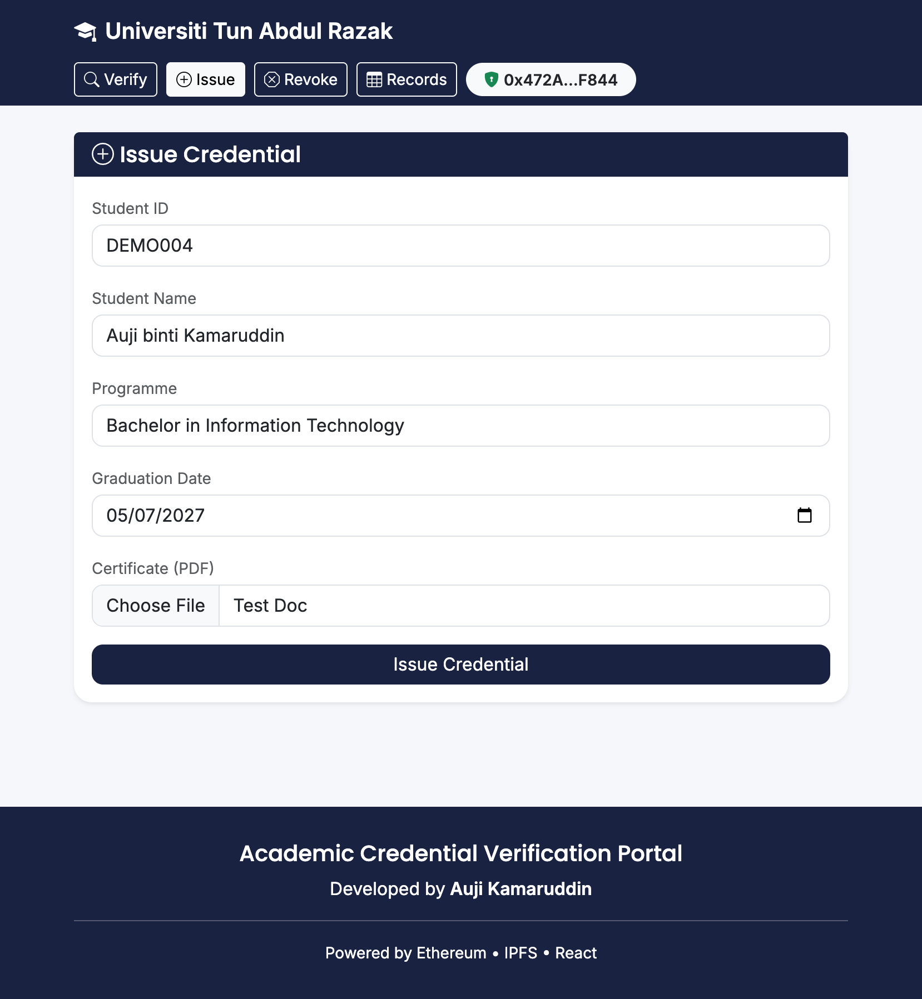
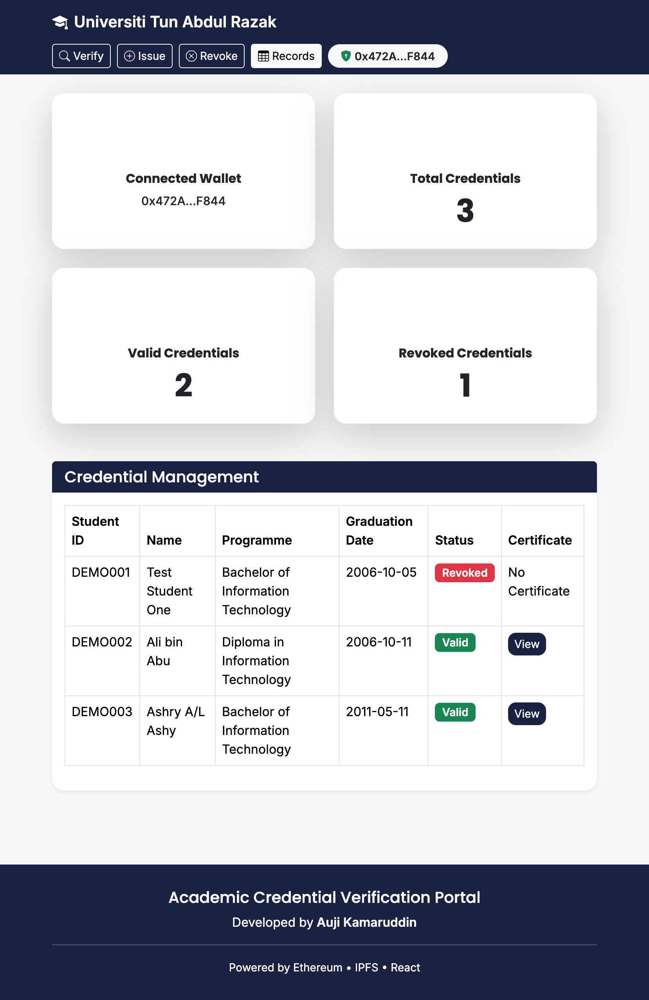
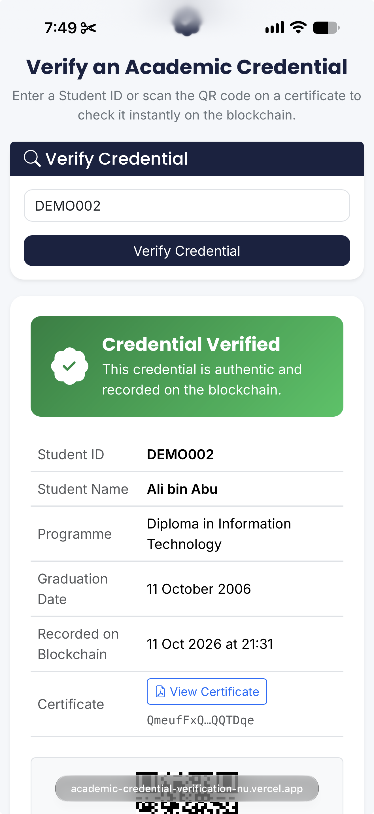
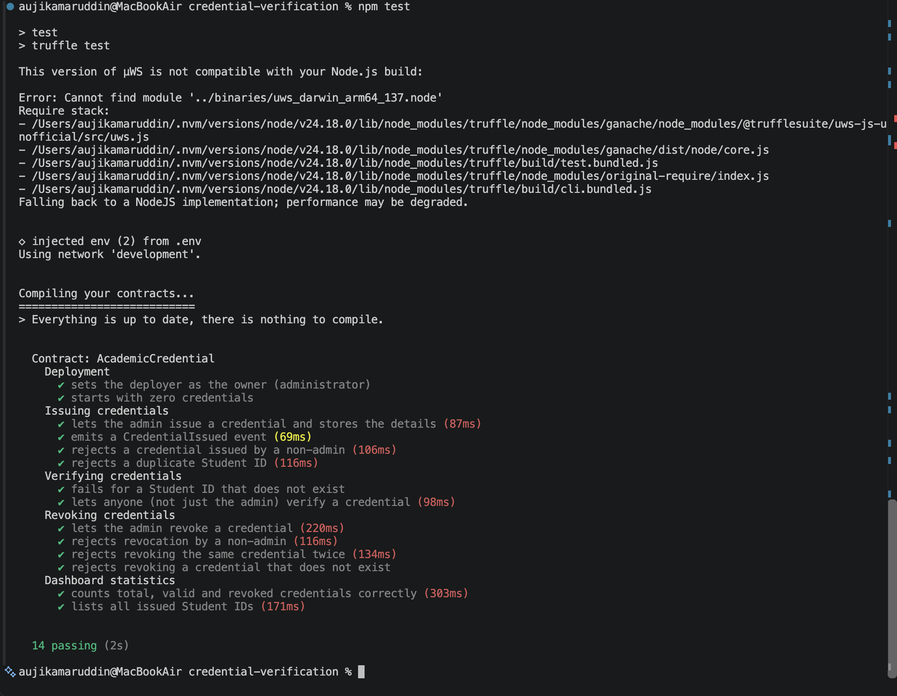

# 🎓 Academic Credential Verification Portal

> Final Year Project (FYP) — Bachelor of Information Technology (Hons.)
> Universiti Tun Abdul Razak (UNIRAZAK)

🌐 **Live demo:** https://academic-credential-verification-nu.vercel.app
⛓️ **Smart contract (Ethereum Sepolia):** [`0x33b2e94F4b28dF5e04d5C79f34Ae875B4a36c011`](https://sepolia.etherscan.io/address/0x33b2e94F4b28dF5e04d5C79f34Ae875B4a36c011)

Try it: open the live demo and verify Student ID **`DEMO002`** — no wallet needed.

---

## 📖 Project Overview

The Academic Credential Verification Portal is a blockchain-based web application for issuing, verifying, and revoking academic credentials.

Credential records are stored on the **Ethereum** blockchain through a Solidity smart contract, and supporting PDF certificates are stored on **IPFS**. Anyone — such as an employer or recruiter — can verify a credential instantly by entering a Student ID or scanning a QR code, **without needing a crypto wallet**. Only the university administrator can issue or revoke credentials.

---

## 💡 Problem Statement

Traditional academic credential verification is often manual, slow, costly, and vulnerable to fake certificates. Employers usually have to contact the university and wait for confirmation.

This project uses blockchain technology to create a tamper-proof record of issued credentials, and decentralized storage (IPFS) for supporting documents, so verification becomes instant, transparent, and trustworthy.

---

## 🎯 Objectives

- Develop a decentralized academic credential verification system.
- Implement Ethereum smart contracts for credential issuance, verification, and revocation.
- Store supporting documents securely using IPFS.
- Allow anyone to verify credentials publicly without a wallet.
- Restrict issuing and revoking to the authorized administrator.

---

## ✨ Features

- ✅ **Public verification (no wallet needed)** — enter a Student ID and see a clear **VERIFIED** or **REVOKED** result read directly from the blockchain.
- 📱 **Shareable link & QR code** — every verified credential has a link (`/?id=...`) and QR code that opens the result instantly on any device.
- 🔐 **Admin login with MetaMask** — the website detects whether the connected wallet is the contract owner and only then shows admin features.
- 🎓 **Issue credentials** — upload the PDF certificate to IPFS and record the details plus the IPFS CID on the blockchain.
- 🚫 **Revoke credentials** — revoked credentials are clearly shown as REVOKED to anyone who verifies them.
- 📋 **Records & dashboard** — view all credentials and statistics (total, valid, revoked).
- 🕒 **Blockchain timestamp** — shows exactly when each credential was recorded on-chain.
- 📲 **Responsive design** — works on desktop and mobile.

---

## 🛠️ Technology Stack

| Category | Technology |
|----------|------------|
| Frontend | React.js, Bootstrap 5, Bootstrap Icons |
| Smart Contract | Solidity 0.8.20 |
| Blockchain | Ethereum Sepolia testnet (local development: Ganache) |
| Development Framework | Truffle Suite |
| Blockchain Library | ethers.js v6 |
| Wallet | MetaMask |
| Decentralized Storage | IPFS via Pinata (local development: IPFS Desktop) |
| QR Codes | qrcode.react |
| Hosting | Vercel (auto-deploys from GitHub) |
| Testing | Truffle tests (Mocha / Chai) |
| Version Control | Git & GitHub |

---

## 🏗️ System Architecture

```text
                 Recruiter / Employer                University Admin
                (any browser or phone)            (browser + MetaMask)
                          │                                │
                          ▼                                ▼
                 ┌──────────────────────────────────────────────┐
                 │        React web app (hosted on Vercel)       │
                 └──────────────────────────────────────────────┘
                     │ read (free,                │ write (signed
                     │ no wallet)                 │ by MetaMask)
                     ▼                            ▼
                 ┌──────────────────────────────────────────────┐
                 │   AcademicCredential.sol  (Ethereum Sepolia)  │
                 │   stores: student details, IPFS CID, status   │
                 └──────────────────────────────────────────────┘
                                       │ CID
                                       ▼
                 ┌──────────────────────────────────────────────┐
                 │        IPFS (Pinata) — PDF certificates       │
                 └──────────────────────────────────────────────┘
```

Only the IPFS **CID** (a unique fingerprint of the file) is stored on the blockchain — not the PDF itself — which keeps blockchain costs low while still proving the document has not been changed.

---

## ⚙️ System Workflow

**Issuing (admin)**
1. The administrator logs in with MetaMask (the contract owner's wallet).
2. Enters the student's details and selects the PDF certificate.
3. The PDF is uploaded to IPFS, which returns a CID.
4. The smart contract records the details, CID, and a timestamp on the blockchain.

**Verifying (anyone)**
1. Enter a Student ID, or scan the QR code / open the shared link.
2. The website reads the credential directly from the blockchain (no wallet required).
3. The result is shown as **VERIFIED** or **REVOKED**, with a link to the certificate on IPFS.

**Revoking (admin)**
1. The administrator enters a Student ID and confirms in MetaMask.
2. The credential is permanently marked as revoked on the blockchain.

---

## 📸 Application Screenshots

### Public Verification


### Verified Result with QR Code


### Revoked Result


### Issue Credential (Admin)


### Records Dashboard (Admin)


### Mobile View


### Smart Contract Tests


---

## 📂 Project Structure

```text
credential-verification/
├── client/                      # React frontend
│   ├── public/
│   ├── src/
│   │   ├── components/          # UI components (Navbar, VerifyCredential, ...)
│   │   ├── contracts/           # Contract ABI + addresses (generated by Truffle)
│   │   ├── services/            # blockchain.js (read-only provider), ipfs.js (uploads)
│   │   ├── utils/               # errors.js, format.js
│   │   └── App.js
│   ├── .env.example             # Frontend settings template
│   └── package.json
├── contracts/                   # Solidity smart contracts
│   └── AcademicCredential.sol
├── migrations/                  # Truffle deployment scripts
├── test/                        # Smart contract tests
├── truffle-config.js            # Networks: development (Ganache), sepolia
├── .env.example                 # Deployment settings template
└── package.json                 # Root scripts (start, test, migrate)
```

---

## 🚀 Running the Project Locally

### Prerequisites
- Node.js (v18+), npm
- Truffle (`npm install -g truffle`)
- Ganache (for local development and tests)
- MetaMask browser extension

### 1. Clone and install
```bash
git clone https://github.com/Gk031098/academic-credential-verification.git
cd academic-credential-verification
npm install
npm --prefix client install
```

### 2. Configure environment variables
```bash
cp .env.example .env
cp client/.env.example client/.env
```
Fill in your own values. To run fully locally, remove the `REACT_APP_RPC_URL`, `REACT_APP_NETWORK_ID`, `REACT_APP_NETWORK_NAME`, `REACT_APP_PINATA_JWT` and `REACT_APP_IPFS_GATEWAY` lines — the app then uses Ganache and IPFS Desktop.

### 3. Deploy the smart contract
Local (Ganache running on port 7545):
```bash
npm run migrate
```
Sepolia testnet (needs Sepolia test ETH in the deployer wallet):
```bash
npm run migrate:sepolia
```

### 4. Start the website
```bash
npm start
```
Open http://localhost:3000

### 5. Run the smart contract tests
With Ganache running:
```bash
npm test
```

---

## 🔒 Security Notes & Limitations

- **Access control:** only the contract owner can issue or revoke (`onlyOwner`). Hiding admin features in the UI is for usability; the real protection is in the smart contract.
- **Public data:** blockchain data is public and permanent. This prototype stores student names on-chain for demonstration and uses **fictional data only**. A production system should store only a hash of personal data to comply with privacy laws (e.g. Malaysia's PDPA).
- **IPFS upload key:** for this prototype, the Pinata key is restricted to upload-only. In production, uploads should go through a backend that verifies the administrator's signature.
- **Single administrator:** one wallet controls issuing. A production system could use multi-signature wallets or role-based access for multiple staff.
- **Testnet:** the system runs on the Sepolia test network; test ETH has no real value.
- **Tooling:** Truffle is now deprecated; a future version could migrate to Hardhat or Foundry.

---

## 👩‍💻 Author

**Auji Kamaruddin**
Bachelor of Information Technology (Hons.)
Universiti Tun Abdul Razak (UNIRAZAK)
Final Year Project (2026)